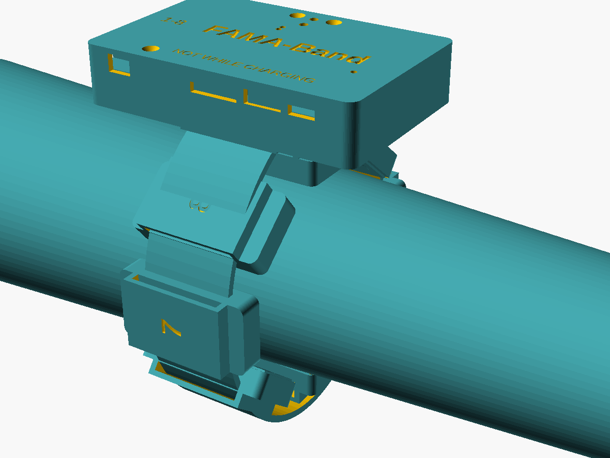
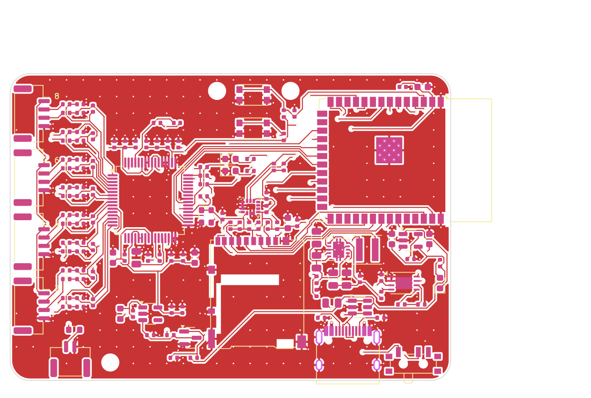
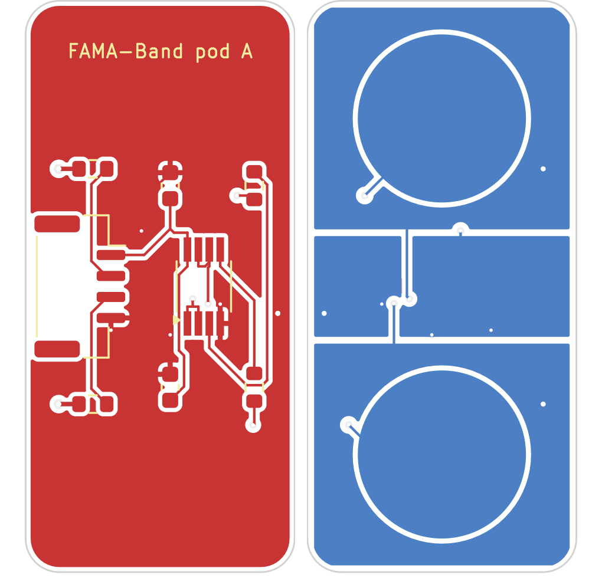

# FAMA-Band: an 8-channel sEMG armband for FAMA-Net

An end-user research device for the **FAMA-Net** thesis (fatigue-aware,
multi-scale adaptive CNN for sEMG gesture recognition). It records
forearm EMG at an exactly known 1 kHz, logs it losslessly, streams it to
the lab PC, and runs FAMA-Net, including both online adaptation tiers,
**on the device**.



| | |
|---|---|
| Channels | 8 bipolar, active dry electrodes (10 mm ENIG, 20 mm IED), driven right leg |
| Sampling | ADS1298 24-bit at 2000 SPS → **1000.00 Hz ± 20 ppm** output, flat ±0.06 dB over 20–450 Hz |
| Noise | 1.61 µVrms input-referred (20–450 Hz, calculated), 105 dB dynamic range |
| Processing | ESP32-S3: thesis pre-processing, STFT [8 × 33 × 9], FAMA-Net, Tier A (causal AdaBN), Tier B (SampEn-triggered head fine-tuning) |
| Data | microSD raw log (2 kSPS) + Wi-Fi UDP or BLE 5 stream, protocol markers in the device timebase |
| Power | 600 mAh Li-Po, ≈5.4 h (BLE) / ≈3.6 h (Wi-Fi) estimated; battery-only while worn with a hardware USB interlock |
| Size | Hub 76 × 50 × 20 mm, pods 19 × 37 × 10.5 mm |

## What's in the repository

| Folder | Content | Status |
|---|---|---|
| [`docs/`](docs) | Research, specification, hardware, mechanics, firmware, safety and ethics, bring-up, wearing protocol, thesis mapping | complete |
| [`hardware/`](hardware) | KiCad 7 projects (hub: 4 layers, pod: 2 layers), schematic PDFs, Gerbers, BOM and pick-and-place, STEP; Python generators | ERC clean, DRC: 0 errors, 0 unconnected |
| [`mechanical/`](mechanical) | Parametric OpenSCAD enclosures, STL files, renders | ready to print |
| [`firmware/`](firmware) | ESP-IDF v5.3 application + portable DSP/ML core (`components/fama_dsp`) | builds (Wi-Fi and BLE variants) |
| [`host/`](host) | Python package `famaband`: reference DSP/model, PyTorch FAMA-Net + exporter, recorder, protocol runner, contact check, simulator; tests | 30 tests passing |

## Documentation

1. [Research: why a custom device, design decisions](docs/01_research.md)
2. [Specification: numbered requirements traced to the thesis](docs/02_specification.md)
3. [Hardware design: circuits, noise, power, safety numbers, PCB](docs/03_hardware_design.md)
4. [Mechanical design](docs/04_mechanical.md)
5. [Firmware and host software](docs/05_firmware.md)
6. [Safety and ethics for use on people](docs/06_safety_and_ethics.md) (**read before any human use**)
7. [Ordering, assembly, bring-up and safety tests](docs/07_assembly_and_bringup.md)
8. [Wearing the band and running a session](docs/08_wearing_and_session_protocol.md)
9. [How the device closes open items of the thesis review sheet](docs/09_thesis_integration.md)

| Hub PCB (top) | Pod (top and skin side) |
|---|---|
|  |  |

## Quick start

```bash
make test        # build the C core for the host and run all tests (needs numpy, scipy, pytest; torch optional)
make hardware    # regenerate schematics + PCBs + fab outputs (KiCad 7, Java, xvfb; about 15 min)
make firmware    # ESP-IDF v5.3 build for the ESP32-S3
make stl         # export enclosure STLs (OpenSCAD)

# with a device (or the simulator: python -m famaband.simulator_device)
cd host
python -m famaband.contact                         # electrode contact check
python -m famaband.protocol_runner --subject S01 --day 1
python -m famaband.io recordings/S01_D1_*.fbr --npz s01d1.npz
```

## Verification status, stated honestly

* **Verified in this repository:**
  * the schematics match the source netlist (KiCad's own netlister) and pass ERC
  * both PCBs pass DRC with no unconnected pads
  * the firmware compiles for the ESP32-S3
  * the firmware's signal chain, network runtime, Tier A/B logic and packet format are tested against independent Python references
  * the protocol tools are tested end to end over UDP against a software device
  * the ADS1298 pinout was cross-checked: the stock KiCad 7.0 symbol swaps pins 3/4, and a corrected symbol is used
* **Not yet verified (needs the physical boards):** analog noise and
  CMRR, sample-rate accuracy, battery life, on-device inference timing,
  radio robustness, fault currents and interlock timing. The procedures
  and pass criteria are in [`docs/07_assembly_and_bringup.md`](docs/07_assembly_and_bringup.md).
  Figures marked "estimate" in the docs come from datasheets and
  calculation.
* **Not a medical device.** Research prototype; ethics approval and
  informed consent are required before any recording on people.
