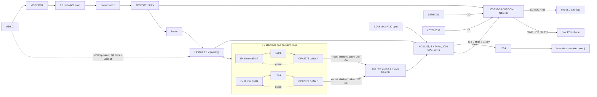

# 3. Hardware design

Two boards: one **hub** (power, analog front end, MCU, storage, radio)
and eight identical **electrode pods** (active dry electrodes). Both
boards are generated from a single Python netlist (`hardware/gen/hub.py`,
`hardware/gen/pod.py`). That netlist produces the KiCad schematics, the
PCB netlist and the BOM, so the three cannot disagree.

| Artefact | Hub | Pod |
|---|---|---|
| KiCad 7 project | `hardware/kicad/hub/` (root + 3 sheets) | `hardware/kicad/pod/` |
| Schematic PDF | `hardware/docs/hub_schematic.pdf` | `hardware/docs/pod_schematic.pdf` |
| Gerbers + drill (zip) | `hardware/fab/hub/hub_gerbers.zip` | `hardware/fab/pod/pod_gerbers.zip` |
| BOM / pick-and-place | `hub_bom.csv`, `hub_cpl.csv` | `pod_bom.csv`, `pod_cpl.csv` |
| 3D board (STEP, outline + pads) | `hub.step` | `pod.step` |
| Size / layers | 66 × 46 mm, 4 layers, 1.6 mm | 16 × 34 mm, 2 layers, 1.6 mm, **ENIG** |

## 3.1 Block diagram



## 3.2 Signal chain per channel

1. **Electrode:** a 10 mm ENIG pad on the pod's skin side. The bipolar
   pair sits 20 mm apart along the forearm axis.
2. **Current limit:** a 100 kΩ series resistor caps the DC current into
   the body at ≤ 33 µA even if the node is shorted to a 3.3 V rail
   (single fault). See §3.5.
3. **Active buffer:** OPA2376 unity-gain follower. Its 0.2 pA bias
   current and > 10 GΩ input impedance make the 0.1–1 MΩ dry-electrode
   contact impedance irrelevant. The buffer output also drives a
   solder-masked guard ring around its electrode, so the
   highest-impedance node sees almost no leakage or capacitive pickup.
4. **Cable:** 47 Ω isolates the op-amp output from cable capacitance.
   The cable is 4-core shielded (3V0, P, N, GND + shield), with the
   shield grounded at the hub only.
5. **EMI filter (hub):** 2.2 kΩ series per line, 1 nF to ground per line
   (common-mode corner 72 kHz) and 10 nF across the pair
   (differential-mode corner 3.44 kHz, −0.07 dB at 450 Hz).
6. **ADS1298:** PGA gain 6, unipolar 3.0 V analog supply, internal
   2.4 V reference, so the input range is ±400 mV and 1 LSB is 47.68 nV.
   High-resolution mode, **2000 SPS** (DR = 100); the reason is in §3.4.
7. **Right-leg drive:** the RLD amplifier senses all 16 inputs (RLD_SENSP
   = RLD_SENSN = 0xFF) and uses the TI-recommended 1 MΩ ‖ 1.5 nF loop.
   Its output drives the bias electrode through 100 kΩ, holding the body
   near mid-supply (≈1.5 V).

**Common-mode window (important for dry electrodes).** With AVDD = 3.0 V
and gain 6, the PGA needs AVSS + 0.2 V + 3·V_diff < V_CM < AVDD − 0.2 V − 3·V_diff:

| Differential DC offset between a pod's two electrodes | Allowed V_CM |
|---|---|
| 10 mV | 0.23 – 2.77 V |
| 100 mV | 0.50 – 2.50 V |
| 300 mV | 1.10 – 1.90 V |

The RLD keeps V_CM at ≈1.5 V, so offsets up to ~300 mV are tolerated.
During donning, `python -m famaband.contact` reports each channel's DC
offset and 50 Hz pickup against these limits. This is also why the bias
electrode must have good contact (`08_wearing_and_session_protocol.md`).

## 3.3 Noise budget (20–450 Hz, input-referred, T = 37 °C)

| Source | Density | In band (430 Hz) |
|---|---|---|
| 2 × 100 kΩ patient-protection resistors | 41.4 nV/√Hz each | 2 × 0.86 µVrms |
| 2 × OPA2376 voltage noise | 7.5 nV/√Hz each | 2 × 0.16 µVrms |
| ADS1298 at G = 6 (4 µVpp in 150 Hz → 49.5 nV/√Hz) | | 1.03 µVrms |
| 2 × 2.2 kΩ filter resistors | 6.1 nV/√Hz each | 2 × 0.13 µVrms |
| **Total (root sum of squares)** | | **1.61 µVrms** |

Dynamic range: 105 dB (full-scale sine against the noise floor), about
17 ENOB. Forearm sEMG runs from roughly 20 µVrms (light contraction) to
over 1 mVrms, so the electronics are not the limit. Dry-electrode contact
noise and motion artefacts dominate in practice, which is why the pods
are active and guarded.
The 100 kΩ resistors are the largest electronic contributor. That is a
deliberate trade: halving them would cut 0.4 µVrms but push the
single-fault current above the 50 µA limit.

## 3.4 Sample rate, clock and the decimation filter

* **Exact rate.** An external 2.048 MHz ± 20 ppm CMOS oscillator clocks
  the ADS1298 (CLKSEL = 0). The modulator runs at f_CLK/4 = 512 kHz, so
  DR = 100 gives exactly 2000 SPS, and the firmware output is exactly
  **1000.00 Hz ± 0.02 Hz**. The internal oscillator (percent-level
  tolerance) is not used. This closes the review sheet's
  "exact sampling rate" item.
* **Why 2000 SPS, not 1000.** The ADS1298's sinc³ decimation filter has
  its −3 dB point at 0.262 × f_DR. At 1 kSPS that is 262 Hz, which would
  remove the 262–450 Hz part of the band the thesis filters for, and
  450 Hz would sit at −9.3 dB (`host/tests/test_dsp.py::test_sinc3_alone_fails_at_1ksps`).
  At 2 kSPS the −3 dB point is 524 Hz. The firmware then applies a 63-tap
  least-squares FIR that inverts the sinc³ droop and rejects everything
  that would alias, and decimates by 2. The combined response is flat
  within ±0.06 dB over 20–450 Hz, with ≥ 58 dB rejection at ≥ 560 Hz
  (`test_decimator_response`).
* The SD card stores the raw 2 kSPS codes, so the decimation can be
  redone offline with any other filter.

## 3.5 Patient safety by design (details and risk table in `06_safety_and_ethics.md`)

| Measure | Value |
|---|---|
| Supply while worn | Battery only (1S Li-Po with protection PCM). No galvanic path to mains |
| USB interlock (hardware) | VBUS → 10k/20k divider → 2N7002 pulls the LP5907 EN low: no 3.0 V rail, so pods, ADS analog section and bias are unpowered whenever USB power is present. The firmware also refuses to start sessions (second, independent layer) |
| DC current into the body, normal condition | Op-amp bias current (pA) and RLD correction current (sub-µA) |
| DC current, single fault (any skin node shorted to a rail) | ≤ 3.3 V / 100 kΩ = **33 µA** (IEC 60601-1 type BF limits for patient auxiliary current: 10 µA normal / 50 µA single fault, DC) |
| Hard power-off | PCM12 slide switch in series with the battery |
| Over-current | 0.5 A PTC on VBUS; cell PCM; TPS63001 current limit |

## 3.6 Power budget (estimates, to be confirmed during bring-up)

| Load on 3.3 V | BLE streaming | Wi-Fi streaming |
|---|---|---|
| ADS1298 (8 ch, HR mode) | 2.0 mA | 2.0 mA |
| 16 × OPA2376 (760 µA typical) | 12.2 mA | 12.2 mA |
| 2.048 MHz oscillator | 4.5 mA | 4.5 mA |
| ESP32-S3 (CPU running inference + radio) | ≈70 mA | ≈120 mA |
| microSD (48 kB/s average write) | ≈10 mA | ≈10 mA |
| IMU, LEDs, fuel gauge | ≈1.7 mA | ≈1.7 mA |
| **Total on 3.3 V** | **≈100 mA** | **≈150 mA** |
| Battery current (η = 90 %, 3.7 V) | ≈100 mA | ≈149 mA |
| **Runtime, 600 mAh (90 % usable)** | **≈5.4 h** | **≈3.6 h** |

Charging: MCP73831 at 1000 V / 2.2 kΩ = 455 mA (0.76 C), about 1.6 h from empty.
The buck-boost runs in forced PWM (PS/SYNC high). That trades a little
light-load efficiency for a fixed ~1.5 MHz switching frequency, far
above the EMG band and the ADC's sinc nulls, with no PFM bursts at audio
or EMG frequencies.

## 3.7 Key parts

| Function | Part | Why |
|---|---|---|
| AFE | TI ADS1298IPAG (TQFP-64) | 8 simultaneous ΔΣ channels, PGA, RLD, 24-bit; hand-solderable package |
| MCU + radio | Espressif ESP32-S3-WROOM-1-N16R8 | 240 MHz dual core with SIMD, 8 MB PSRAM for the model and buffers, pre-certified Wi-Fi + BLE 5 |
| Electrode buffer | TI OPA2376AIDGKR | 0.2 pA bias, 7.5 nV/√Hz, rail-to-rail I/O on 3.0 V |
| Clock | SiT8008 2.048 MHz ± 20 ppm (2520 footprint) | Exact sample rate |
| Analog LDO | TI LP5907MFX-3.0 | 6.5 µVrms output noise, EN used by the interlock |
| 3.3 V | TI TPS63001 buck-boost | Uses the whole Li-Po range (3.0–4.2 V) |
| Charger / gauge | MCP73831-2 / onsemi LC709203F | Simple, well documented |
| IMU | ST LSM6DSL | Orientation context for pronation/supination |
| Storage | Hirose DM3AT microSD | Lossless raw log |

Full BOMs with manufacturer part numbers: `hardware/fab/*/…_bom.csv`.
Approximate cost of the parts for one band is 200–250 USD (the ADS1298
alone is about a quarter of that; prices not verified, they change).

## 3.8 PCB implementation

**Hub, 4 layers:** signal / GND plane / signal + GND pour / signal + GND
pour.

* **Partitioning.** The analog section (pod connectors, EMI filters,
  ADS1298, analog LDO) sits on the left. The digital and RF section
  (ESP32-S3, microSD, USB, power) is on the right. They share one
  unbroken ground plane on In1, with no split, as TI recommends for the
  ADS129x.
* **Connectors.** The eight pod connectors sit on the left edge, four on
  each board side. They are interleaved (ch8, 7, 6, …, 1 top to bottom)
  so every channel reaches its ADS1298 pins without crossing another.
* **Antenna.** The ESP32-S3 module's antenna overhangs the right board
  edge by 6 mm, with a copper keep-out on all layers for the part still
  over the board.
* **Routing.** Freerouting 1.9 autoroutes the board, with KiCad's
  connectivity driving a repair pass. GND reaches the plane through 105
  generated fan-out vias plus a stitching-via grid. Routing used a
  0.20 mm clearance; sign-off is at 0.15 mm (JLCPCB-class 4-layer rules:
  0.127 mm min track, 0.45/0.20 mm vias).
* **Result.** DRC reports **0 unconnected pads, 0 clearance errors**.
  The remaining warnings are silkscreen lines of the deliberately
  overhanging parts (USB-C, switch, antenna) crossing the board edge.

**Pod, 2 layers, ENIG.** Bottom (skin): two 10 mm electrodes, each
inside a solder-masked guard zone driven by its own buffer output. A GND
strip runs between them. Top: buffer, resistors and connector, all 0603
or larger for hand assembly (eight pods per band). DRC: 0 violations,
0 unconnected.

> Electrode finish: order the pods with **ENIG** (or hard gold, which
> wears longer) and *no* solder mask over the electrode pads, which the
> footprint already specifies. Expect to replace pods after heavy use;
> they are about 6 USD each.

## 3.9 Verification status

| Check | How | Result |
|---|---|---|
| Netlist ERC (every pin connected or marked NC, power pins driven, no output conflicts) | `circuit.py::erc` | 0 errors (hub, pod) |
| Schematic ↔ source netlist | `kicad-cli sch export netlist` compared net by net | identical (hub, pod) |
| ADS1298 pinout | KiCad 7 symbol vs TI pin table + an independent symbol | KiCad 7.0 swaps pins 3/4; corrected symbol in `hardware/lib/famaband.kicad_sym` |
| PCB DRC | `pcbnew.WriteDRCReport` | hub: 0 errors, 0 unconnected; pod: 0 violations |
| Board bring-up on real hardware | `07_assembly_and_bringup.md` | **not yet done**: boards still to be manufactured |

## 3.10 Regenerating

```bash
sudo apt install kicad openscad xvfb default-jre    # KiCad 7.x
hardware/tools/get_freerouting.sh                    # downloads freerouting-1.9.0.jar
python3 hardware/gen/build_sch.py                    # schematics, ERC, netlist check, PDF, BOM
python3 hardware/gen/build_pcb.py pod hub            # place, route, DRC, Gerbers (hub ~15 min)
```
Autorouting is not deterministic. A rerun gives a different (equally
DRC-clean) copper layout, so commit the generated boards you actually order.
