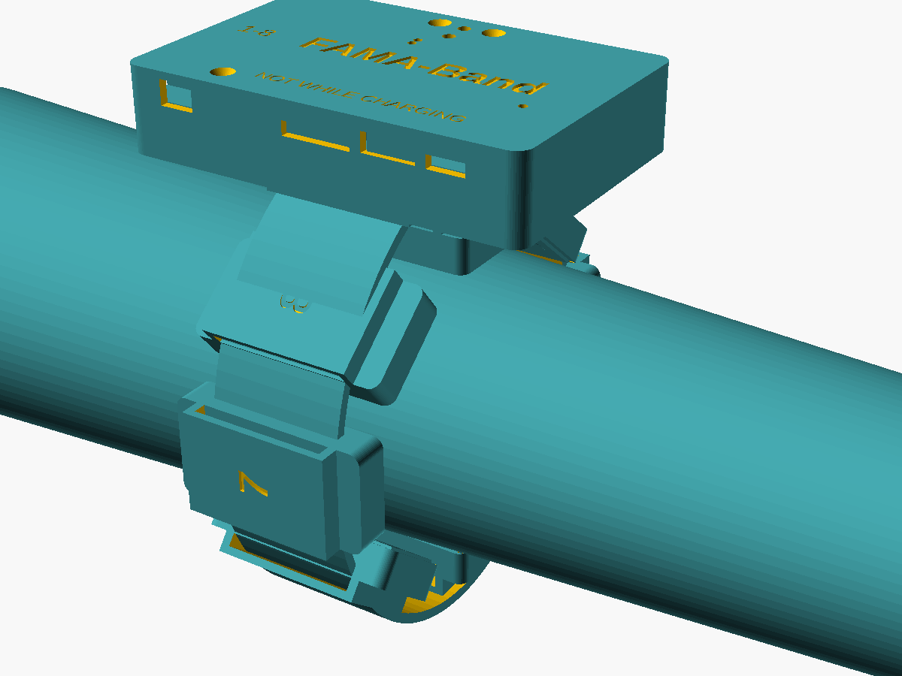
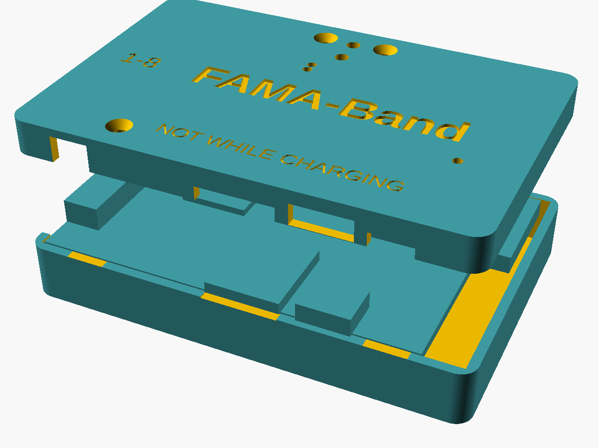
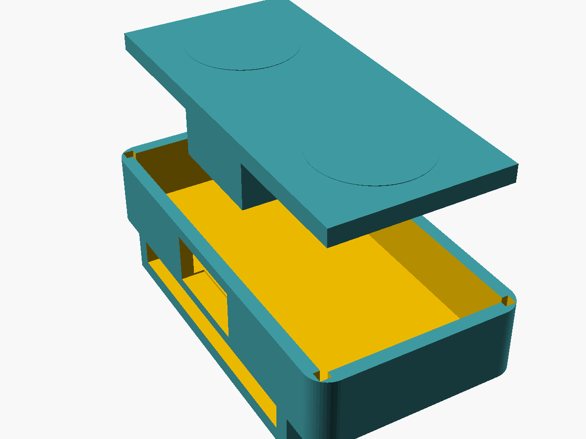

# 4. Mechanical design

Everything is in one parametric OpenSCAD file, `mechanical/famaband.scad`.
PCB feature positions (connectors, buttons, LEDs, mounting holes) are
copied from the KiCad layouts.

| Part | File | Size (W × L × H) | Print |
|---|---|---|---|
| Electrode pod housing (× 8, + spares) | `mechanical/stl/pod.stl` | 19.0 × 37.0 × 10.5 mm | PETG or biocompatible resin, upside down (bridge on the bed), 0.2 mm layers |
| Hub base (tray, strap loops, PCB standoffs) | `mechanical/stl/hub_base.stl` | 76.3 × 50.4 × 13.6 mm | PETG, floor down |
| Hub lid | `mechanical/stl/hub_lid.stl` | 76.3 × 50.4 × 6.0 mm | PETG, top down (exported already flipped) |



## 4.1 Concept

* **Ring of eight pods on a 25 mm elastic strap.** Each pod has a strap
  tunnel across its short axis. The strap runs around the forearm while
  the electrode pair stays aligned with the forearm (muscle-fibre) axis.
  The pods slide along the strap, so one band fits forearm circumferences
  of about 20–32 cm (two strap lengths). They are spaced evenly by eye
  using printed marks on the strap.
* **Electrodes stand 0.5 mm proud** of the housing rim (`pod_protrude`),
  so the strap tension presses the gold pads, not the plastic, onto the skin.
* **Hub on the outside of the strap.** Its long axis lies along the
  forearm, over the dorsal side. The strap passes through two loops under
  the hub's centre. The hub never touches the skin. All eight pod cables
  leave through the hub's elbow-side wall (four from each PCB side) and
  run in the strap to their pods.
* **Wrist-side wall openings:** USB-C, microSD slot, power switch and
  the bias-electrode lead. The lid has pin holes for RESET and BOOT/USER,
  light holes for the green (recording), blue (link) and red (charging)
  LEDs, and the embossed warning "NOT WHILE CHARGING".

## 4.2 Hub stack-up (z, from the skin side)

| Layer | Thickness |
|---|---|
| Strap loops | 3.8 mm (below the floor) |
| Floor | 1.4 mm |
| 600 mAh Li-Po (40 × 30 × 6 mm) on foam tape, plus bottom-side pod connectors | 6.8 mm |
| PCB | 1.6 mm |
| Tallest top-side part (JST GH 4.25 mm) + clearance | 4.6 mm |
| Lid | 1.4 mm |

The base and lid split at the PCB top surface. Three M2 × 12 countersunk
screws pass through the lid bosses and the PCB mounting holes into the
base standoffs, clamping the PCB between them.

## 4.3 Pod assembly

1. Solder the pod. Clean the flux off the electrodes with isopropanol.
2. Press the PCB into the housing from the skin side (electrodes out),
   with the cable connector at the notch.
3. Put one drop of UV-curing resin or cyanoacrylate in each of the four
   corner glue pockets. Keep it off the electrodes.
4. Plug in the cable. Secure it with a dab of hot glue in the notch as
   strain relief.
5. Mark polarity: the "+" moulded next to the top electrode marks pad E1 (P input).

The housing's channel number is a parameter: `pod_housing(ch)` engraves 1–8.

## 4.4 Cables and strap

* **Pod cables:** 4-core shielded cable, OD ≤ 2.5 mm, about 25 cm (pods
  1, 8) up to about 35 cm (pods 4, 5). Fit a JST GH 4-pin housing
  (GHR-04V-S) at each end, wired 1:1: pin 1 +3V0, 2 P, 3 N, 4 GND +
  shield. Connect the shield only at the hub end.
* **Bias lead:** JST GH 2-pin to a 4 mm snap for a standard disposable
  Ag/AgCl electrode, placed on the olecranon or the ulnar styloid.
* **Strap:** 25 mm elastic woven strap with a hook-and-loop closure.
  Mark the channel-1 position with a coloured stitch so the band can be
  put on the same way every session.

## 4.5 Rendering / regenerating

```bash
cd mechanical
openscad -D 'part="pod"'      -o stl/pod.stl      famaband.scad
openscad -D 'part="hub_base"' -o stl/hub_base.stl famaband.scad
openscad -D 'part="hub_lid"'  -o stl/hub_lid.stl  famaband.scad
xvfb-run openscad --render -D 'part="exploded"' --imgsize=1200,900 -o renders/assembly_exploded.png famaband.scad
```
Other views: `hub_exploded`, `pod_exploded`, `assembly`. The board STEP
files in `hardware/fab/*/` can be imported into a MCAD tool for fit checks.

| | |
|---|---|
|  |  |
