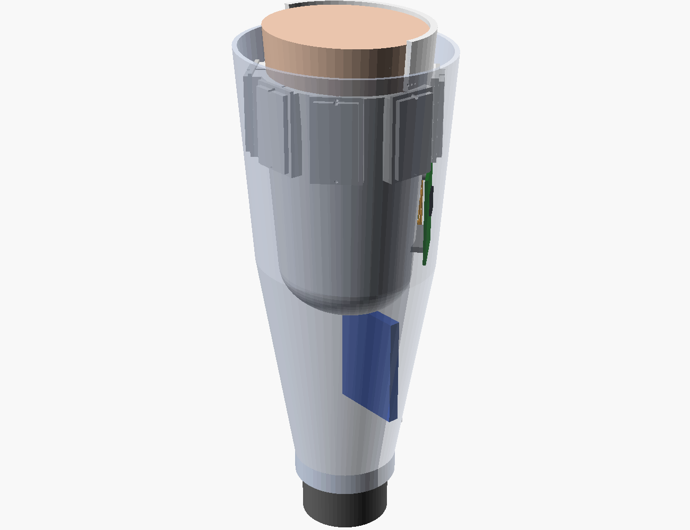
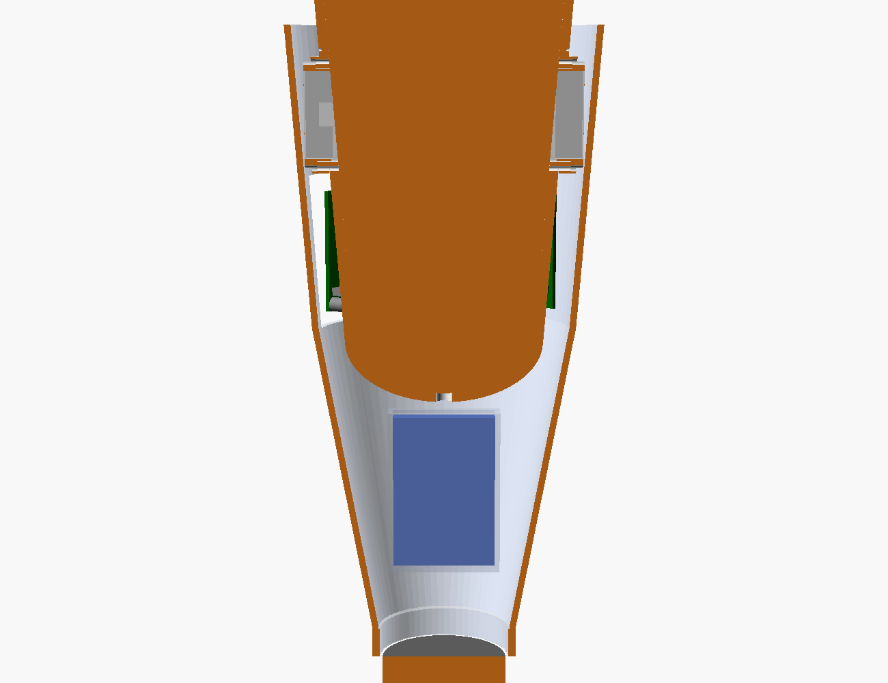
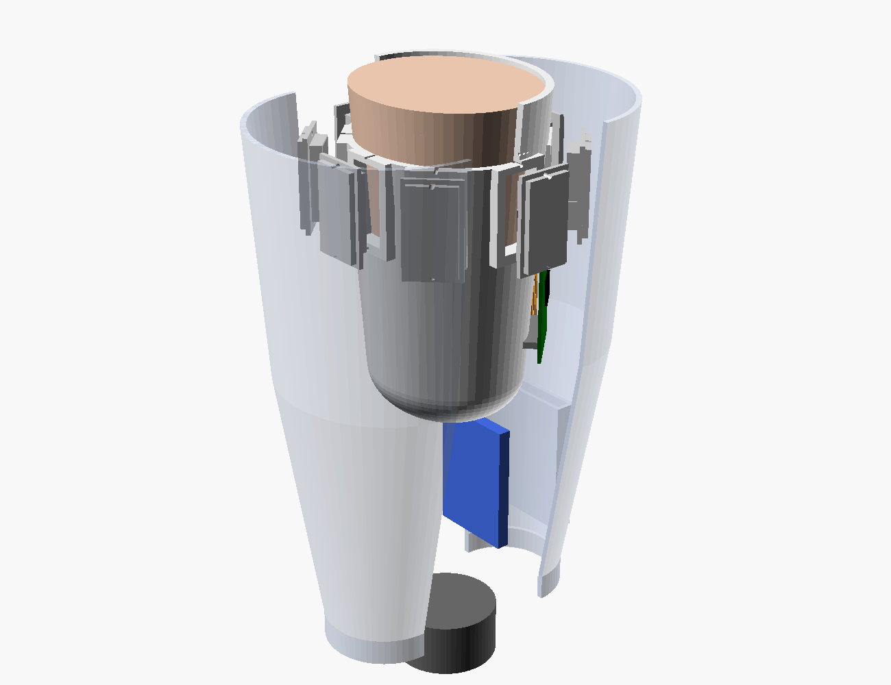
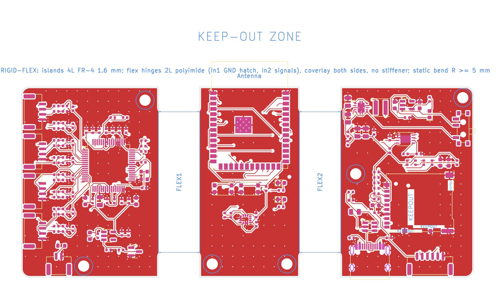
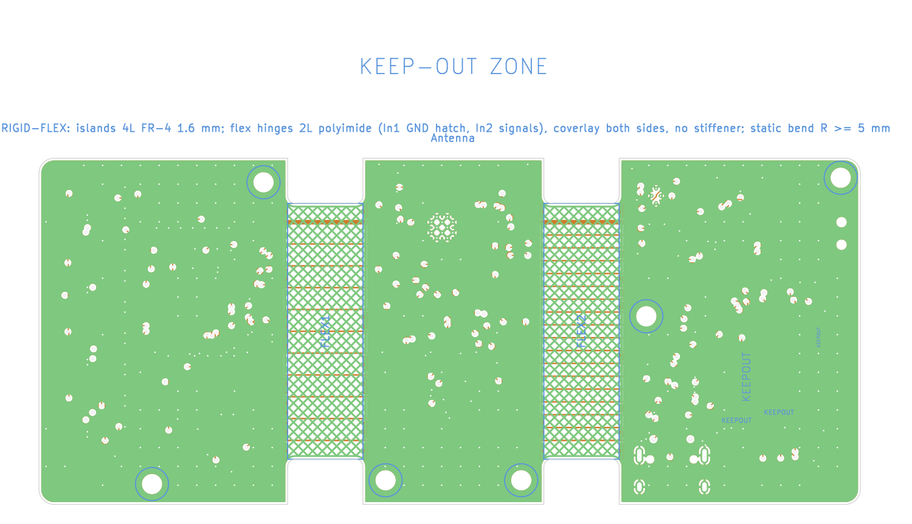

# 10. FAMA-Band in a transradial prosthetic socket

The armband version is for data collection on intact arms. This variant
builds the same electronics into a **transradial myoelectric prosthesis
socket**. The electrodes sit in the socket wall; the hub becomes a
**rigid-flex board** wrapped around the socket; and FAMA-Net's decisions
drive a prosthetic hand through a terminal-device interface.



| | Armband | Socket |
|---|---|---|
| Electrodes | 8 pods on an elastic strap | The same 8 pods in **screw-in cartridges** in the inner-socket wall |
| Hub | Rigid 66 × 46 mm, own enclosure | **Rigid-flex**: 3 rigid islands + 2 flex hinges wrapped 120° around the socket, inside the forearm frame |
| Output | Wi-Fi/BLE + SD | + **hand interface**: UART result packets and two proportional 0–3.3 V outputs |
| Battery | 600 mAh | 1500 mAh in the distal frame: ≈18 h with radio off, ≈13.6 h with BLE (estimates) |
| Firmware | `sdkconfig.defaults` | + `sdkconfig.socket` (`CONFIG_FAMA_BOARD_SOCKET`) |

## 10.1 Mechanical architecture (`mechanical/socket.scad`)

| Part | File | Notes |
|---|---|---|
| Inner socket | `stl/socket_inner_socket.stl` | 3.5 mm wall. Print in PA12 (SLS) or PETG-CF. Anterior cubital relief, posterior olecranon extension, distal valve port (suction option). 8 electrode ports with flat seating bosses; pod number marked as dots above each port |
| Electrode cartridge (× 8) | `stl/socket_cartridge.stl` | Holds one standard pod PCB with the electrodes 0.5 mm proud of the inner surface, so socket pressure gives consistent contact. Fixed with 2 × M2 × 6 into the boss; the cable exits sideways |
| Hub carrier | `stl/socket_hub_carrier.stl` | Bonded to the socket's posterior outer surface. 6 standoffs, 6 mm high to clear the bottom-side connectors. Their tops form three flat facets: each rigid island sits flat and only the hinges bend |
| Forearm frame (2 halves) | `stl/socket_frame_anterior.stl`, `stl/socket_frame_posterior.stl` | Tapers from the socket to a **Ø50 mm wrist lamination ring** for a standard quick-disconnect wrist unit. Battery bay ribs distally; 12 mm gap to the socket for the electronics (hub stack 10.8 mm). The frame can be slimmed locally away from the posterior hub |
| Service door | `stl/socket_service_door.stl` | Over island C: USB-C, microSD, power switch and charge LED |

All geometry is driven by limb measurements: `limb_len`, `circ_prox`,
`circ_dist`, `ml_ap`, and `forearm_len` matched to the sound side. For a
real patient, replace `limb()` with the rectified 3D scan
(`import("limb_scan.stl")`); ports, carrier and frame are placed relative
to the same axis.

| | |
|---|---|
|  |  |

## 10.2 Fitting workflow (with a certified prosthetist)

1. **Scan and rectify** the residual limb (the prosthetist's normal process). Print a clear **check socket** from it first.
2. **Electrode site mapping:**
   * With the check socket on, place adhesive Ag/AgCl electrodes or
     loose pods through test windows.
   * Use `python -m famaband.contact` and `famaband.record` to find sites
     with clear, separable activity for the 8 gestures.
   * FAMA-Net needs a ring of 8 channels. Spread the pods evenly around
     the proximal third, the default in `elec_angles`, unless mapping
     shows dead zones (scar tissue, thin soft tissue over bone). Move
     those ports with `elec_angles` / `elec_z`.
3. **Print the definitive inner socket.** Deburr the port edges and fit the cartridges.
4. **Route the pod cables** over the socket surface to the hub, fixed with
   adhesive cable clips. Mount the rigid-flex hub on the carrier
   (6 × M2 × 4). Bend the hinges only once, during installation.
5. **Close the frame** (clamshell, 6 × M3, bonded to the socket at the
   brim). Fit the wrist unit and hand. Connect the hand interface (§10.4).
6. **Calibrate:**
   * Record a short session in the socket (`protocol_runner` with fewer cycles).
   * Fine-tune FAMA-Net on it and export `fama_net.bin` to the card.
   * Enable the hand outputs only after the classifier has been checked
     with the hand disconnected.

> **Thesis note: domain shift.** Socket electrodes are not at the same
> positions as the armband electrodes, and residual-limb EMG differs from
> intact-arm EMG. Treat armband and NinaPro DB2 data as **pre-training**
> and the socket calibration session as **fine-tuning data**. Tier A
> (AdaBN) is designed for exactly this kind of distribution shift.
> Pattern-recognition studies also report better robustness to electrode
> shift with larger inter-electrode distances (4 cm vs 2 cm) and mixed
> orientations. The pod's 20 mm IED is kept for compatibility with the
> armband data; a 40 mm pod is a simple PCB variant if the thesis
> explores it.

## 10.3 Rigid-flex hub (`hardware/kicad/hub_flex/`)

Same schematic as the armband hub, plus the hand interface. It is
generated by `hub.build("socket")` and `build_pcb.py hub_flex`.





| Region | Board x | Content |
|---|---|---|
| Island A (rigid) | 0–33 mm | 8 pod connectors (both sides), EMI filters, ADS1298, 2.048 MHz clock, analog LDO, USB interlock |
| Flex 1 | 33–43 mm | 11 signals on In2: AFE SPI and control, AFE_EN, VBUS_DET, +3V3 |
| Island B (rigid) | 43–67 mm | ESP32-S3 module (antenna past the distal edge, into the air space of the frame), IMU, buttons, LEDs; module decoupling and EN RC on the bottom side |
| Flex 2 | 67–77 mm | 18 signals on In2: USB D±, microSD, I²C, fuel-gauge alert, VBUS_DET, hand UART/PWM, +3V3 |
| Island C (rigid) | 77–109 mm | USB-C, charger, buck-boost, fuel gauge, microSD, power switch, hand connector, battery connector (bottom) |

**Stack-up (fab note on `Cmts.User`):**
* Rigid islands: 4 layers, FR-4, 1.6 mm.
* Flex hinges: the 2-layer polyimide core (L2 = In1 GND, L3 = In2
  signals) continues through the hinges, with coverlay on both sides.
* No copper on L1/L4 in the flex area, and no stiffener.

**Flex design rules (enforced by the generator; KiCad 7 has no native
rigid-flex stack-up, so they are rule areas):**

| Rule | Implementation |
|---|---|
| No components, outer-layer copper or vias in the flex | Rule areas `FLEX1`/`FLEX2` on F.Cu/B.Cu: no tracks, vias, pours or footprints |
| No vias near the rigid/flex transition | Via keep-out 1.3 mm (≈ 0.050″) beyond each transition on all layers |
| Traces perpendicular to the bend, evenly spaced, uniform width | Every crossing net is a pre-routed, locked, straight In2 track (0.2 mm; 0.6 mm for +3V3), evenly spaced across the hinge. Lanes end as In2 stubs 1.5 mm inside each island; the router connects there and places vias only outside the keep-out (an earlier version with a fixed column of lane vias walled off the island edges and blocked routing) |
| Continuous return path but flexible copper | GND on In1 runs through the hinge as a **cross-hatched** plane (0.25 mm lines, 0.65 mm gaps, 45°) |
| Tear resistance | 1 mm fillets at every inner corner where a hinge meets an island; hinges are 34 mm tall, narrower than the 46 mm islands |
| Bend radius | Mounted geometry: ≈42° per hinge at R ≈ 13.5 mm, far above the 6–10 × thickness static minimum (≈ 1–2 mm) |

**Ordering:**
* Rigid-flex costs roughly 3–5 × as much as rigid. Ask the fab for
  "4-layer rigid-flex, flex core L2–L3, flex regions per the Cmts.User
  drawing".
* A cheaper fallback is **semi-flex** FR-4 (depth-milled to about
  0.25 mm in the hinge areas, bend once). It uses the same layout, and
  In2 stays the routed layer.

## 10.4 Hand interface (connector J13, JST GH 6-pin, island C distal edge)

| Pin | Signal | Notes |
|---|---|---|
| 1 | +3V3 | ≤ 50 mA for logic level shifters only; the hand has its own battery |
| 2 | TX | UART0, 115200 8N1, 330 Ω series. Sends one `FB_T_RESULT` packet (format in `05_firmware.md`) per 100 ms window: gesture, probabilities, ŝ, SampEn |
| 3 | RX | 330 Ω series, 100 kΩ pull-up (reserved for hand → hub messages) |
| 4 | OUT1 | PWM 20 kHz → 10 kΩ / 1 µF (16 Hz) → 0–3.3 V proportional "open" (default gesture 2, open palm) |
| 5 | OUT2 | Same, "close" (default gesture 1, fist) |
| 6 | GND | |

* **UART:** use it with hand controllers you can program (open-source
  hands, research controllers).
* **OUT1/OUT2:** these mimic a conventional two-site myoelectric input.
  Check the hand's input range: many commercial hands expect 0–5 V, so a
  non-inverting gain of 1.5 may be needed. Commercial hands may also
  require their manufacturer's interface to be connected at all.

**Output behaviour** (`fama_td_*` in `fama_dsp.h`, tested in `host/tests/test_td.py`):
* Confidence gating with hysteresis: an output turns on when its class
  probability exceeds 0.7 and off when it falls below 0.5.
* A proportional level, smoothed with τ ≈ 0.3 s.
* Open and close are never driven together.
* The outputs are **disabled after power-up** until the prosthetist
  sends `CMD_TD_ENABLE` (or `CONFIG_FAMA_TD_ENABLE_AT_BOOT` is set).
* A watchdog forces both outputs to 0 V if results stop for 300 ms, for
  example after USB insertion, a fault or a reset.

Build:
```bash
idf.py -B build_socket -D SDKCONFIG=build_socket/sdkconfig \
  -D SDKCONFIG_DEFAULTS="sdkconfig.defaults;sdkconfig.socket" build
# all-day use without radio: add CONFIG_FAMA_RADIO_OFF=y (data on microSD only)
```

## 10.5 Power for daily use (estimates)

| Mode | 3.3 V load | Battery current | 1500 mAh runtime |
|---|---|---|---|
| Prosthesis mode, radio off | ≈ 75 mA | ≈ 75 mA | ≈ 18 h |
| BLE streaming | ≈ 100 mA | ≈ 100 mA | ≈ 13.6 h |

The FAMA-Band battery powers only the sensing electronics; the hand
keeps its own battery pack. The battery bay sits between the distal
limb end and the wrist. For long residual limbs there may not be room;
use a flatter 2 × 750 mAh pack along the frame instead.

## 10.6 Safety: what changes for a prosthesis user

Everything in `06_safety_and_ethics.md` still applies. Additionally:

| Hazard | Control |
|---|---|
| **Unintended hand movement** (misclassification, fault) causing injury or dropped objects | Outputs off by default; confidence gating, hysteresis, mutual exclusion and a 300 ms watchdog. Hand tested disconnected first. The prosthetist keeps the hand's own safety limits (grip-force limit). Sessions start with the hand away from the body and with no objects held |
| Skin breakdown from socket pressure or electrode edges | Socket fitted by a certified prosthetist; deburred, rounded port edges; electrodes only 0.5 mm proud; skin inspection after every session; wear time increased gradually |
| Sweat ingress into the electronics | Conformal-coat the hub; cartridges sealed to the socket with a silicone bead; electrodes cleaned daily |
| Charging while worn | Same hardware interlock as the armband (VBUS disables the analog rail); the service door is on the outside of the frame and the charging procedure says "remove the prosthesis first" |
| Unsupervised long-term use | **Not permitted** with this research prototype. Use only in supervised lab sessions, under an ethics approval that covers participants with limb loss |

## 10.7 Verification status

| Item | Status |
|---|---|
| Socket-hub schematic: ERC, KiCad netlist = source | Done (`build_sch.py`) |
| Rigid-flex PCB DRC (flex rule areas included) | **0 errors, 0 unconnected pads.** Warnings: 6 silkscreen lines of the deliberately overhanging parts at the board edge, 1 silk-over-mask, 1 dangling 0.13 mm GND stub inside the ground pour at the IMU. No router copper inside either hinge (checked by the build) |
| Socket firmware build (`sdkconfig.socket`) | Compiles with ESP-IDF v5.3.1 |
| Hand-output mapping | 5 unit tests (`test_td.py`) |
| Socket, cartridge, carrier, frame fit | CAD only. Needs a check-socket fitting with a prosthetist |
| Rigid-flex bend durability, hand-interface electrical tests, battery life | Not yet done (needs hardware) |
